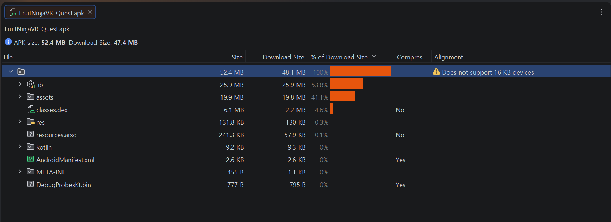
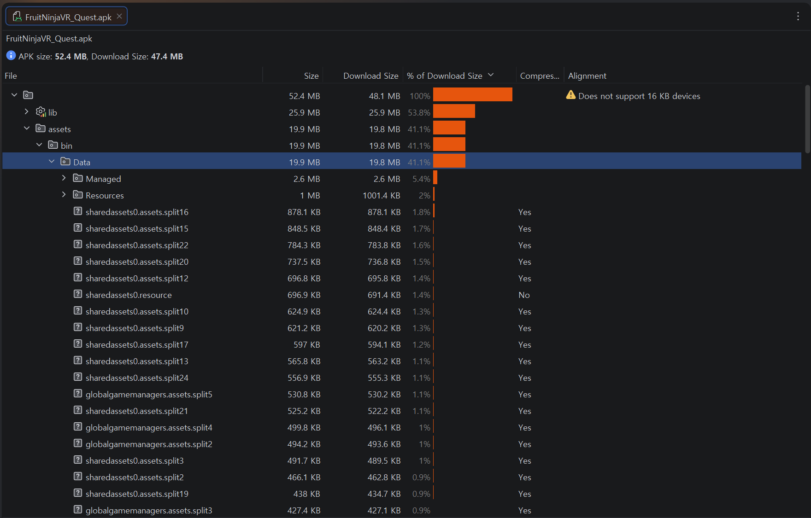
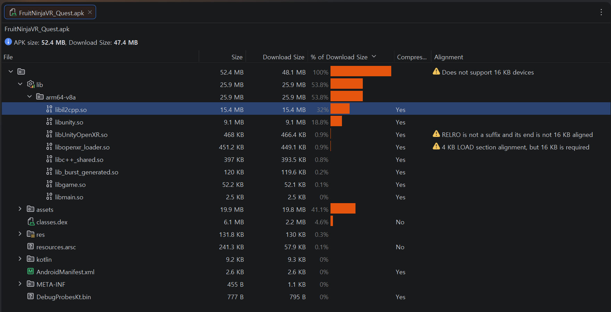
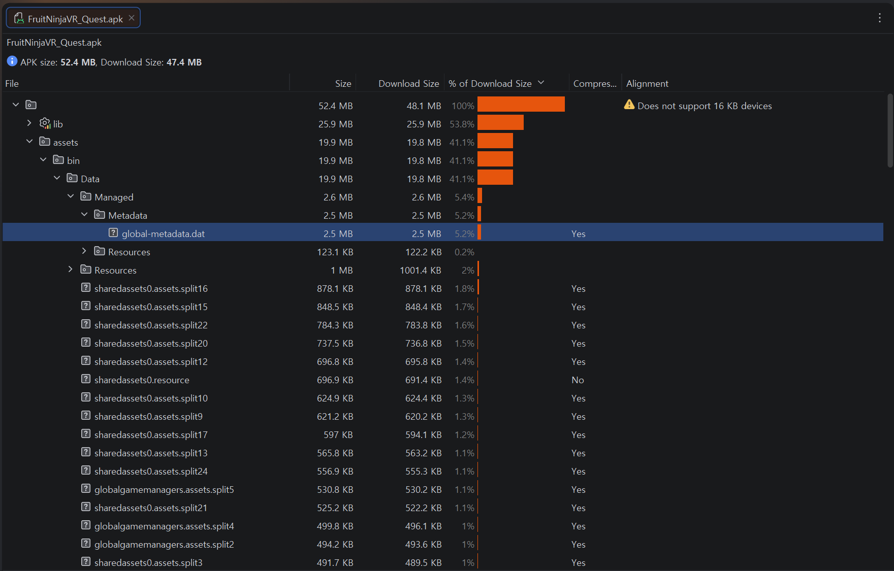

# Fruit Ninja VR – Part 1 – Task 5 : analyse de l'APK et comparaison des builds

Builds analysés : Unity 6000.0.56f1, commit de la branche `part1` du 15/11/2026.
Unités : **o** = octet ; **Mo** = 10⁶ o ; **Mio** = 2²⁰ o = 1 048 576 o (l'explorateur Windows affiche des Mio
sous le nom « Mo »).

## 1. Tailles

| Fichier | Octets | Mo | Mio |
|---|---:|---:|---:|
| APK Quest `Builds/Quest/FruitNinjaVR_Quest.apk` (APK Analyzer : « APK size: 52.4 MB ») | 54 978 059 | 54,98 | 52,43 |
| Taille de téléchargement estimée (APK Analyzer : « Download Size: 47.4 MB » ; `apkanalyzer apk download-size`) | 49 709 272 | 49,71 | 47,41 |
| Contenu de l'APK une fois décompressé (somme des 538 entrées) | 149 395 739 | 149,40 | 142,47 |
| ZIP Windows `Builds/FruitNinjaVR_Windows.zip` | 71 893 731 | 71,89 | 68,56 |
| Dossier Windows livré (sans `*_BurstDebugInformation_DoNotShip`) | 152 831 671 | 152,83 | 145,75 |
| Dossier Windows complet produit par Unity | 153 130 213 | 153,13 | 146,04 |

**APK Analyzer d'Android Studio** (Android Studio 2026.2.2, *Build > Analyze APK…*) affiche
**APK size: 52.4 MB, Download Size: 47.4 MB**. Ses « MB » sont des Mio (2²⁰ o) : 52,4 Mio = 54,98 Mo,
47,4 Mio = 49,71 Mo, ce qui correspond exactement aux valeurs ci-dessus. Sa colonne *Size* donne la taille de
chaque entrée **dans l'archive** (compressée), *Download Size* la taille estimée une fois recompressée pour
le téléchargement depuis un store.

Le dossier `FruitNinjaVR_BurstDebugInformation_DoNotShip` (298 542 o) contient des symboles de débogage
qu'Unity demande de ne pas distribuer : il est exclu du ZIP.

**Compression.** Un APK est une archive ZIP : l'APK (55,0 Mo) contient 149,4 Mo de données, soit un taux de
36,8 %. Le ZIP Windows réduit le dossier de 152,8 Mo à 71,9 Mo (47,0 %). Il faut donc comparer
*APK ↔ ZIP* (deux archives) et *contenu de l'APK ↔ dossier Windows* (deux contenus décompressés), pas
l'APK au dossier. Le Windows compresse moins bien parce que ses textures sont en formats GPU PC (BC) déjà
denses, et que `UnityPlayer.dll` et les assemblies .NET sont livrés en plus.

## 2. Contenu de l'APK

Inventaire fait en ligne de commande : lecture de l'archive (Python `zipfile`, regroupement des fichiers
`.splitN` d'Unity) et `apkanalyzer` (outil en ligne de commande du SDK Android fourni avec Unity, appelé
directement par `java` car son script `.bat` ne gère pas l'espace de « Program Files »).

| Bloc | Compressé (o) | Décompressé (o) | Rôle |
|---|---:|---:|---|
| `lib/arm64-v8a/libil2cpp.so` | 16 154 279 | 64 842 888 | **code C# du jeu et des paquets (XRI, Input System, URP…) converti en C++ puis compilé en ARM64** par IL2CPP |
| `lib/arm64-v8a/libunity.so` | 9 510 783 | 21 609 264 | moteur Unity (runtime natif) |
| `lib/arm64-v8a/libUnityOpenXR.so` + `libopenxr_loader.so` | 941 282 | 2 987 136 | plug-in OpenXR d'Unity et loader OpenXR (lien avec le runtime du Quest) |
| autres `.so` (libc++_shared, burst, libgame, libmain…) | ≈ 0,6 M | ≈ 1,8 M | bibliothèque C++ standard, code Burst, amorce |
| **Total `lib/`** | **27 191 845** | **91 273 760** | |
| `assets/bin/Data/sharedassets0.assets` (26 morceaux `.splitN`) | 12 705 909 | 26 304 848 | **données de la scène : textures, meshes, matériaux, shaders utilisés** |
| `assets/bin/Data/globalgamemanagers.assets` (6 morceaux) | 2 363 176 | 5 969 560 | réglages du projet et assets globaux (shaders toujours inclus, réglages XR, URP…) |
| `assets/bin/Data/Managed/` | 2 743 181 | 10 187 579 | `global-metadata.dat` d'IL2CPP : noms des types et méthodes (réflexion, sérialisation) |
| `assets/bin/Data/Resources/` | 1 050 896 | 4 315 768 | ressources intégrées d'Unity (`unity_builtin_extra`, `unity default resources`) |
| `assets/bin/Data/sharedassets0.resource` | 713 632 | 713 632 | **audio** (8 sons MP3 recompressés en Vorbis), stocké sans compression ZIP |
| autres fichiers de `assets/bin/Data` (fichiers nommés par GUID, `globalgamemanagers`, `data.unity3d`…) | ≈ 1,3 M | ≈ 3,7 M | métadonnées de build, configuration des sous-systèmes (OpenXR), table des scènes |
| **Total `assets/bin/Data`** | **20 875 949** | **51 181 510** | |
| `classes.dex` | 6 436 464 | 6 436 464 | code Java/Kotlin de l'activité Unity et des bibliothèques Android (43 221 références de méthodes) |
| `res/`, `resources.arsc`, `AndroidManifest.xml`, `META-INF/` | ≈ 0,4 M | ≈ 0,5 M | ressources Android (icône, chaînes), manifeste, signature |

Manifeste (`apkanalyzer`, `aapt dump badging`) : package `com.JunghoonKIM.FruitNinjaVR`, version 0.1.0 (code 1),
`minSdkVersion 29`, `targetSdkVersion 36`, ABI `arm64-v8a` seule, fonctionnalités
`android.hardware.vr.headtracking`, `android.hardware.vulkan.version` et `oculus.software.eye_tracking`
(ajoutées par la feature Meta Quest Support).

## 3. Ce qui occupe le plus de place

1. **Le code natif (49 % de l'APK compressé)** : `libil2cpp.so` seul fait 16,2 Mo compressé / 64,8 Mo
   décompressé. Il contient tout le C# des paquets, pas seulement les ~15 scripts du jeu. Le niveau de
   *stripping* est « Minimal » : un niveau plus élevé réduirait cette taille, au risque de retirer du code
   appelé par réflexion.
2. **Les textures** : d'après le rapport de build d'Unity, elles font 73,5 % des assets du jeu sur Android
   (25,5 Mo décompressés) contre 84,3 % sur Windows (46,1 Mo). Le plus gros asset est le ciel HDR
   `citrus_orchard_road_puresky_4k.exr` : **14,3 Mo en ASTC (Quest) contre 32,0 Mo en BC6H (PC)**.
   Viennent ensuite le décor `dojo mockup.fbx` (4,0 Mo de meshes), la texture de la pomme (2,4 Mo) et le logo
   du splash screen Unity (1,2 Mo).
3. Meshes 4,4 Mo, shaders 2,4 Mo (Android) / 1,8 Mo (Windows), sons 0,7 Mo : faibles.

| Catégorie (rapport de build Unity, décompressé) | Quest (Android) | Windows |
|---|---:|---:|
| Textures | 25,5 Mo (73,5 %) | 46,1 Mo (84,3 %) |
| Meshes | 4,4 Mo (12,6 %) | 4,4 Mo (8,0 %) |
| Shaders | 2,4 Mo (6,9 %) | 1,8 Mo (3,4 %) |
| Sons | 0,7 Mo (2,0 %) | 0,7 Mo (1,2 %) |
| Autres assets | 1,3 Mo (3,6 %) | 1,3 Mo (2,3 %) |
| **Total des assets du jeu** | **34,7 Mo** | **54,7 Mo** |

Le « Complete build size » de 775,6 Mo affiché par Unity pour Android compte des fichiers intermédiaires
(symboles IL2CPP non strippés, projet Gradle) qui ne sont pas dans l'APK.

## 4. Limites de l'analyse

- APK Analyzer signale « **Does not support 16 KB devices** » : `libUnityOpenXR.so` et `libopenxr_loader.so`
  (plug-in OpenXR d'Unity et loader Khronos) sont alignés sur des pages de 4 Ko et non de 16 Ko. Cela concerne
  les appareils Android configurés en pages de 16 Ko ; ces deux bibliothèques viennent des paquets et ne
  sont pas modifiables dans le projet. Sans effet constaté à ce jour (APK pas encore testé dans le casque).
- APK Analyzer (comme cet inventaire) voit **les fichiers de l'archive, pas les assets Unity** : textures,
  meshes et sons sont regroupés dans `sharedassets0.assets` (découpé en `.splitN`) et `sharedassets0.resource`.
  La répartition par type d'asset vient du rapport de build d'Unity (Editor.log), pas de l'APK.
- `libil2cpp.so` est du code machine : l'outil n'indique pas quelle partie vient de quel script ou paquet.
- La taille de téléchargement est une estimation de l'outil ; la taille installée sur le casque n'a pas été
  mesurée.

## 5. Captures de l'APK Analyzer

Android Studio 2026.2.2 (installé par `winget install Google.AndroidStudio`), APK ouvert dans l'APK
Analyzer, tri par « % of Download Size » :

| Capture | Contenu |
|---|---|
|  | vue d'ensemble : APK size 52.4 MB, Download Size 47.4 MB ; `lib` 53,8 %, `assets` 41,1 %, `classes.dex` 4,6 % du téléchargement |
|  | `assets/bin/Data` déplié : morceaux `sharedassets0.assets.splitN` (données de la scène), `globalgamemanagers.assets.splitN`, `sharedassets0.resource` (audio, non compressé) |
|  | `lib/arm64-v8a` : `libil2cpp.so` 15.4 MB (32 % du téléchargement), `libunity.so` 9.1 MB (18,8 %), avertissements d'alignement 16 Ko sur les bibliothèques OpenXR |
|  | plus gros fichier de données Unity : `Managed/Metadata/global-metadata.dat` (2.5 MB dans l'APK, 5,2 %) ; `sharedassets0.assets` est plus gros au total (12,7 Mo compressés) mais découpé par Unity en 26 morceaux de moins de 1 Mo |

## 6. Lien avec les tests (Task 4)

À compléter après les tests au casque (`docs/checklist-casque.md`) : qualité des effets, lisibilité,
fluidité (FPS avec OVR Metrics Tool) et limitations observées sur chaque plateforme. Choix déjà faits pour
le Quest et justifiés dans `docs/particules.md` et `docs/builds.md` : effets allégés (÷4 particules, sans
collision ni soft particles), qualité Mobile (MSAA 4x, sans HDR ni post-process), textures ASTC.
**Aucun test dans le casque n'a été fait à ce jour.**
