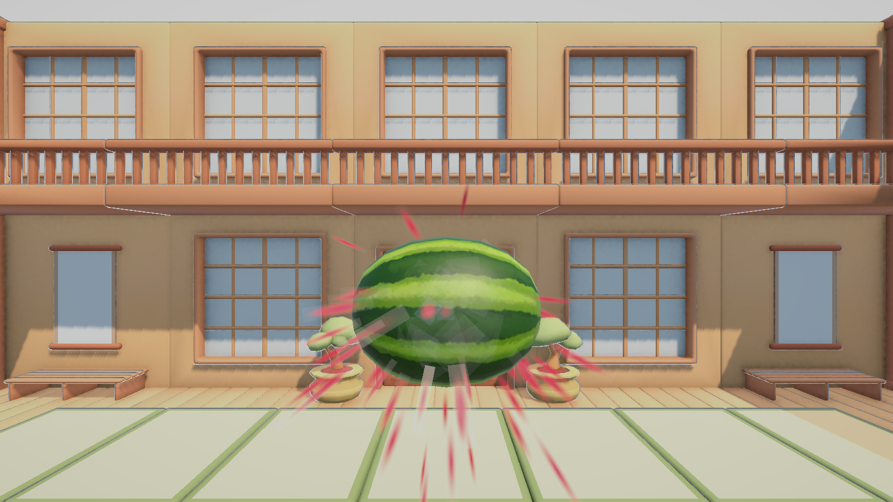
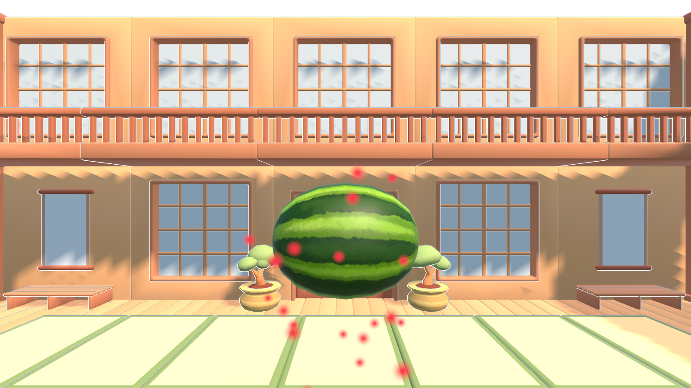
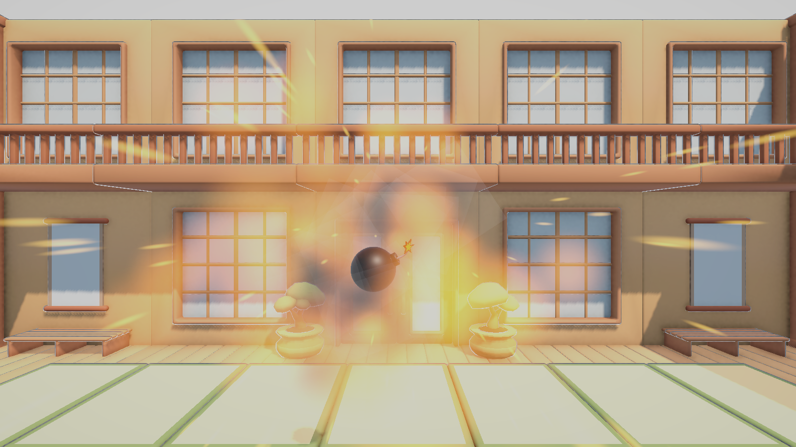
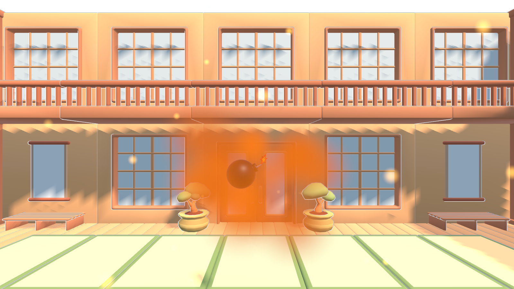

# Fruit Ninja VR – Part 1 – Task 3 : Particle Systems PCVR et Quest

Le projet S7 n'avait **aucun Particle System** (seulement la découpe du mesh, le tremblement et le flash
blanc de la bombe). Deux effets ont été créés, chacun en deux variantes :

| Effet | Prefab PCVR | Prefab Quest | Déclenchement |
|---|---|---|---|
| Éclaboussure de jus | `Assets/FX/Prefabs/FX_FruitJuice_PCVR` | `FX_FruitJuice_Quest` | `KatanaSlicer.TrySliceFruit` : au **point de contact** (point du collider du fruit le plus proche de la lame), teinté de `FruitController.juiceColor` (rouge pastèque, orange, jaune banane…) |
| Explosion de bombe | `Assets/FX/Prefabs/FX_BombExplosion_PCVR` | `FX_BombExplosion_Quest` | `BombController.OnTouch` : **petite explosion (échelle 0,5) à chaque touche**, au moment où la pénalité est appliquée (−25 points, −1 vie) ; explosion complète au moment de l'explosion finale (3e touche, avec le son d'explosion et le flash) |

Les effets sont générés par `Assets/Editor/FruitNinjaTools/FXBuilder.cs` (menu
`Tools > Fruit Ninja > Générer les effets de particules`), donc reproductibles et modifiables.

## Sélection de la variante par plateforme

Le composant `GameFX` (objet `GameFX` de la scène, script `Assets/Scripts/FX/GameFX.cs`) référence les
quatre prefabs. Avec `variant = Auto` (réglage par défaut), il utilise la variante **Quest quand le code est
compilé pour Android** (directive `#if UNITY_ANDROID` : build APK, ou éditeur en cible Android) et la variante
**PCVR sinon** (build Windows, éditeur en cible Windows). Au démarrage il écrit dans le log
`[GameFX] variante utilisée : Quest (FX_FruitJuice_Quest, FX_BombExplosion_Quest)` : on le vérifie dans
`Player.log` (Windows) ou avec `adb logcat -s Unity` (Quest). Le champ `variant` permet de forcer une variante
pour comparer dans l'éditeur.

## Paramètres retenus

### Éclaboussure de jus

| Paramètre | PCVR | Quest | Pourquoi |
|---|---|---|---|
| Sous-systèmes | 2 : gouttes + brume | 1 : gouttes | chaque système = un draw call et une simulation en plus |
| Particules (burst / max) | 60 + 25 = 85 / 110 | 20 / 24 | coût CPU de simulation et surtout *overdraw* des particules transparentes, critique sur le GPU mobile du Quest |
| Durée de vie | gouttes 0,5–0,9 s ; brume 0,3–0,5 s | 0,3–0,5 s | moins de particules vivantes en même temps lors des coupes en série |
| Vitesse / taille des gouttes | 1,5–3,5 m/s ; 0,015–0,04 m | 1,2–2,5 m/s ; 0,035–0,06 m | moins nombreuses, les gouttes Quest sont plus grosses et restent près du fruit pour rester lisibles |
| Rendu | Stretched Billboard (gouttes étirées selon la vitesse) | Billboard | les gouttes étirées donnent le mouvement ; le simple billboard suffit à la taille d'affichage du Quest |
| Gravité | 1 | 1 | — |
| Collision | **oui** : World, qualité Medium, rebond 0,2, perte de vie 0,4 (les gouttes tombent sur le sol) | **non** | les collisions World font des requêtes physiques par particule : coût inutile sur Quest (consigne du sujet) |
| Matériau | `FX_Juice_PCVR` : URP *Particles/Lit*, alpha blend, **soft particles** | `FX_Juice_Quest` : URP *Particles/Unlit*, alpha blend, sans soft particles | le Lit calcule l'éclairage par pixel ; les soft particles lisent la texture de profondeur (désactivée sur le renderer Quest) |
| Texture | `FX_SoftDot` 64×64 (disque à bord doux) | idem | une seule petite texture partagée |
| Couleur | couleur du fruit, fondu en fin de vie | idem | — |

### Explosion de bombe

| Paramètre | PCVR | Quest | Pourquoi |
|---|---|---|---|
| Sous-systèmes | 4 : flash, boule de feu, étincelles, fumée | 3 : flash, boule de feu, étincelles | la fumée (grosses particules transparentes longues) est la pire source d'overdraw |
| Particules (burst / max) | 1 + 60 + 100 + 25 = 186 / 221 | 1 + 16 + 24 = 41 / 51 | divisé par ~4,5 |
| Durée de vie | feu 0,5–0,9 s ; étincelles 0,4–1 s ; fumée 1,5–2,5 s | feu 0,5–0,7 s ; étincelles 0,3–0,6 s | effet terminé en moins de 0,8 s sur Quest |
| Boule de feu | 0,25–0,6 m, additive, rotation aléatoire, **Noise** (turbulence) | 0,4–0,75 m, **alpha blend**, pas de Noise | Noise = calcul par particule et par frame ; sans HDR ni bloom sur Quest, l'additif se perdait sur le décor clair (1er essai peu lisible), d'où l'alpha blend et des particules plus grosses |
| Étincelles | 4–8 m/s, Stretched Billboard, **collision World** | 3–6 m/s, Billboard, 0,05–0,08 m, sans collision | même raison que pour le jus |
| Flash | 1 particule de 1,5 m, 0,15 s | 1 particule de 1,2 m, 0,12 s | lisibilité immédiate du coup, coût négligeable |
| Matériaux | `FX_Fire_PCVR` (Particles/Unlit additif, soft), `FX_Smoke_PCVR` (Particles/Lit alpha, soft) | `FX_Fire_Quest` (Unlit additif), `FX_Fireball_Quest` (Unlit alpha), sans soft particles | shaders les plus simples d'URP ; pas d'éclairage, pas de lecture de profondeur |
| Échelle à une touche non fatale | 0,5 | 0,5 | feedback de pénalité distinct de l'explosion finale |

Paramètres communs : `Simulation Space = World` (les particules ne suivent pas la bombe ni le fruit),
`Scaling Mode = Hierarchy`, `Play On Awake = off` (lancées par `GameFX`), pas d'ombres projetées ni reçues,
destruction automatique de l'instance après durée + durée de vie max.

Réglages du rendu Quest liés (Task 4) : qualité `Mobile`, MSAA 4x, HDR désactivé, post-process désactivé,
pas de texture de profondeur. Cela explique aussi la différence de teinte du décor entre les captures.

## Captures comparables

`Assets/Editor/FruitNinjaTools/FXCapture.cs` rend la scène de jeu depuis le point de vue du joueur
(hauteur des yeux 1,6 m, face aux points de lancement), même cadrage et même instant de simulation
(jus : 0,12 s après la coupe ; bombe : 0,25 s). La variante PCVR est rendue avec le niveau de qualité **PC**,
la variante Quest avec le niveau **Mobile** (celui du Quest). Ce sont des rendus de l'éditeur, **pas des
captures dans le casque** : à refaire en jeu (Windows : capture d'écran du miroir ; Quest :
`adb exec-out screencap -p`).

| | PCVR | Quest |
|---|---|---|
| Jus (pastèque) |  |  |
| Explosion |  |  |

Le fruit est montré entier (la découpe du mesh n'est faite qu'en jeu).

Particules vivantes à l'instant de la capture (`captures/fx-stats.csv`) :

| Effet | PCVR | Quest |
|---|---|---|
| Jus | 85 (max 110) | 20 (max 24) |
| Explosion | 185 (max 221) | 40 (max 51) |

## Impact observé

- Mesuré : nombre de particules vivantes (÷4 pour le jus, ÷4,6 pour l'explosion), nombre de systèmes
  (2→1 et 4→3), modules coûteux retirés (collision, noise, soft particles, éclairage).
- **Non mesuré à ce jour** : FPS et temps GPU dans le casque. À relever avec OVR Metrics Tool sur Quest et
  le compteur de Meta Quest Link / SteamVR sur PC (voir `docs/checklist-casque.md`).
